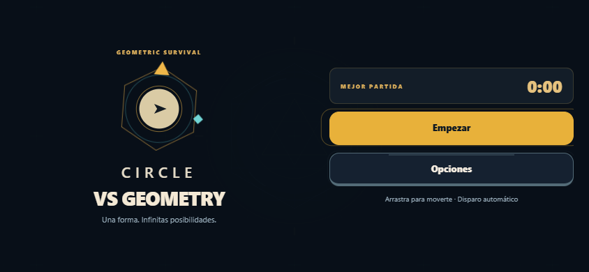
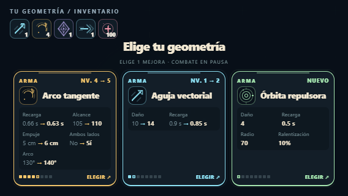
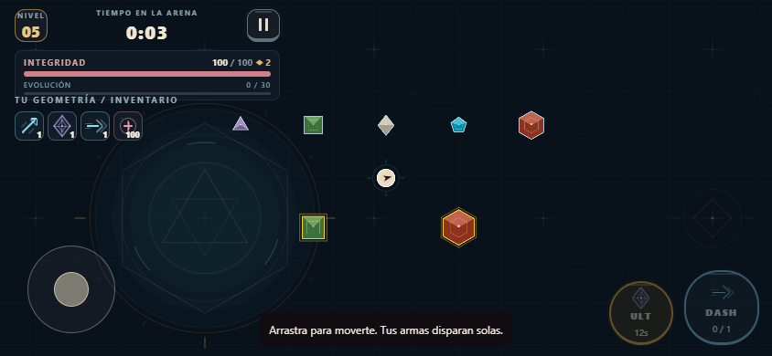
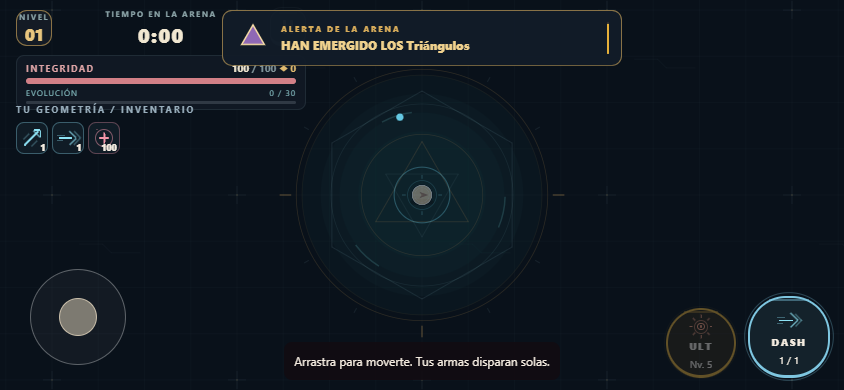

# Juego horizontal y rendimiento

Actualizado el 8 de noviembre de 2026. Rama `visual`.

## Distribución y combate

La aplicación solicita orientación horizontal en la configuración de Expo y al arrancar. En iPad usa pantalla completa para permitir el bloqueo de orientación. Las áreas seguras se aplican al HUD, al inventario y a los controles.

El menú separa identidad y acciones en dos columnas. Vida, experiencia, reloj e inventario ocupan una franja compacta. Al subir de nivel, las tres mejoras se presentan en una fila; en teléfonos de 568×320 se reducen los espacios y la ilustración para conservar todos los cambios tácticos. Pausa, opciones y derrota tienen su propia distribución horizontal.

El héroe es un círculo real con un indicador direccional. Triángulos, cuadrados, rombos, pentágonos y hexágonos conservan sus siluetas; las facetas, contornos dorados de élite y bordes de congelación facilitan reconocerlos. La arena usa grabados discretos y un sello central anclados al mundo.

Los avisos de aparición muestran la figura correspondiente, entran desde arriba y se dibujan delante de la barra de vida. Dejan pasar los toques y caducan con el tiempo del motor. El joystick conserva el dedo de movimiento mientras otro activa DASH o ULT, en cualquier orden.

## Trabajo para alcanzar 60 FPS

El dibujo deja de actualizar React en cada frame. En nativo, Skia recibe el picture mediante un valor compartido de Reanimated; en web se sustituye directamente el picture de la vista. El HUD se refresca cada 100 ms. El reloj fijo del motor y sus colisiones se conservan.

Las siluetas vectoriales se rasterizan una vez a triple resolución y se reutilizan como imágenes. La caché mantiene hasta 256 variantes y tiene respaldo vectorial si no hay superficie raster disponible. Se reutilizan el grabador, Paint y el adaptador de dibujo. El suelo agrupa trazos y descarta adornos fuera de cámara.

La carga puede reducir solamente las cifras de daño y chispas visibles: de 64/80 a 28/40, con histéresis para recuperarlas. Los enemigos, proyectiles y objetos recogibles siguen dibujándose; su simulación y daño no cambian. La telemetría está limitada a 240 muestras.

## Mediciones

Edge con CanvasKit, Intel UHD Graphics, resolución de dibujo 1×, ventanas de 12 segundos. Se registran cuadros enviados desde JavaScript; esto no mide presentaciones de GPU ni acredita 60 FPS en un celular.

| Escenario | Pantalla | FPS medios enviados | Intervalo p95 | Trabajo CPU p95 |
| --- | --- | ---: | ---: | ---: |
| Inicio de partida, aparición automática | 844×390 | 59,09 | 16,9 ms | 2,9 ms |
| Carga: 260 enemigos, 127 proyectiles, 100 recogibles, 5 armas | 844×390 | 58,01 | 17,1 ms | 11,6 ms |
| Misma carga | 1280×720 | 59,84 | 17,0 ms | 9,0 ms |

Audio silenciado y jugador invulnerable para mantener la ventana de medición. Las escenas de carga se preparan con datos de prueba. No hubo errores de consola. La caché utilizó 11 imágenes y aproximadamente 553 KiB de píxeles en carga. La memoria del informe es solo el heap de JavaScript, excluye GPU y recursos externos.

Estos resultados se aproximan al objetivo de 60 FPS, con alguna caída; no garantizan 60 estables en todos los dispositivos. Falta una compilación nativa en hardware real, pruebas largas, temperatura, memoria total y latencia táctil.

Los informes originales de estas mediciones se conservan en [performance-results.json](performance-results.json). Para regenerarlos con el servidor de QA activo:

```sh
npm run test:landscape
npm run test:performance
npm run test:performance -- --normal
```

`QA_URL` permite seleccionar otro servidor. Las capturas e informes regenerados van a `qa/`; la puerta de entrada al motor solo existe en desarrollo con `EXPO_PUBLIC_QA=1`.

## Capturas de control de calidad

Emulación táctil en Edge; no son capturas de un dispositivo físico.








