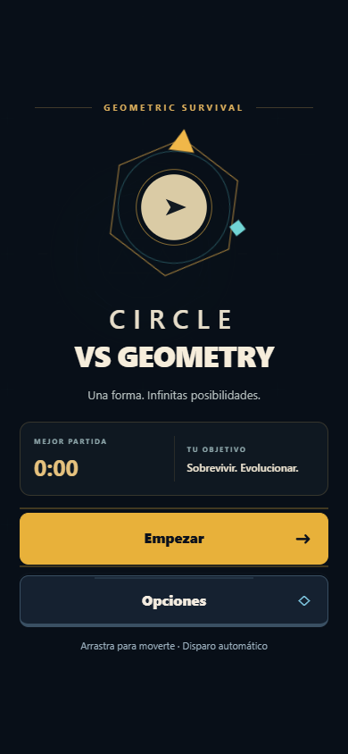
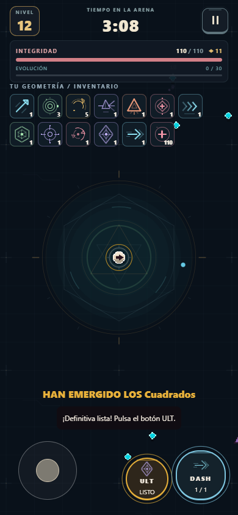
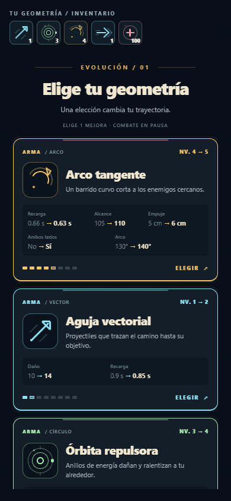

# Interfaz de supervivencia geométrica

La rama `visual` presenta una identidad propia de roguelite en orientación horizontal: emblema orbital animado, menú centrado en la siguiente partida, HUD de integridad y evolución, inventario de formas y resumen con los resultados reales de la partida.

## Un lenguaje geométrico coherente

Cada objeto tiene nombre, familia, ilustración geométrica y color propios. El mismo dibujo aparece en su tarjeta, su espacio del inventario y la animación de adquisición. Los iconos se dibujan con vistas nativas y están memoizados; no dependen de emojis, fuentes ni descargas.

| Armas            | Formas pasivas    | Definitivas          |
| ---------------- | ----------------- | -------------------- |
| Aguja vectorial  | Núcleo circular   | Diamante absoluto    |
| Arco tangente    | Vector de impulso | Supernova radial     |
| Órbita repulsora | Coraza hexagonal  | Constelación orbital |
| Prisma lineal    | Radio magnético   |                      |
| Delta explosiva  | Ciclo vital       |                      |

La interfaz dispone de nombres y textos en español e inglés. Los identificadores internos y las reglas del motor se conservan.

## Elegir cómo evolucionar

Las tarjetas muestran la categoría, la familia de formas, la función del objeto, su nivel y los cambios numéricos del siguiente nivel. Los datos salen de las tablas reales del juego. Se muestran todos los cambios tácticos, incluidos ralentización, empuje y desbloqueo de ataques por ambos lados; no se inventan rarezas ni bonificaciones.

Al elegir, las demás tarjetas se atenúan y el objeto recorre un arco hacia su destino medido en el inventario. La mejora se aplica una sola vez al completar el recorrido. El combate permanece detenido durante la elección. Las preferencias de movimiento reducido conservan las funciones con transiciones breves.

## Respuesta durante la partida

La vida y la experiencia cambian con transiciones suaves. El jugador tiene un halo discreto y respuestas visuales al aparecer, recoger experiencia, recibir daño y subir de nivel. La arena combina grabados finos, un sello central y medallones de polígonos que permanecen anclados al mundo. La decoración mantiene menos contraste que el combate.

## Capturas

Capturas de la vista de control de calidad en Edge con emulación táctil y CanvasKit. La configuración evolucionada se prepara mediante datos de prueba para inspeccionar todos los objetos; no demuestra una partida real ni una prueba física.

| Menú                           | Inventario evolucionado               | Mejora con efectos tácticos          |
| ------------------------------ | ------------------------------------- | ------------------------------------ |
|  |  |  |

La distribución horizontal actual, sus capturas y mediciones se documentan en [Juego horizontal y rendimiento](HORIZONTAL.md).

## Validación

128 pruebas del motor, entrada y modelo de presentación aprobadas; TypeScript, ESLint y exportación de JavaScript/Hermes para Android/iOS aprobados. Se aprobaron 18 comprobaciones de flujo distribuidas entre `test:mobile`, `test:visual` y `test:rogue`, incluyendo pantallas de 320×568, 390×844 y tableta, dos dedos, adquisición única, traducciones, interrupciones, derrota y reinicio.

Ejecutar `npm run qa:serve` y, en otra terminal, los comandos de prueba. Se puede cambiar el servidor con `QA_URL`. La compilación nativa y la comprobación en Android/iPhone reales siguen pendientes.
