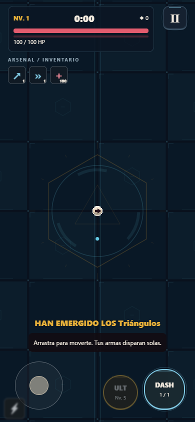
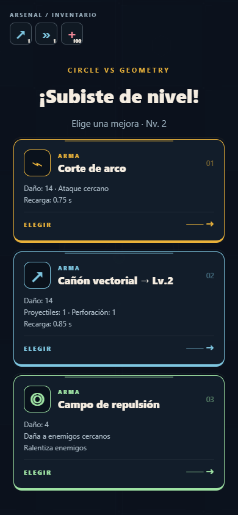
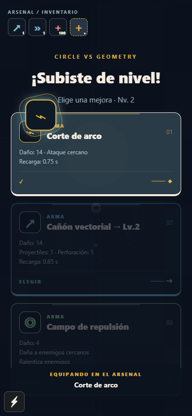

# Rama visual

## Botones y selección

Botones con borde de panel, relieve inferior, compresión al pulsar, rebote al soltar y onda de luz. DASH y ULT pulsan cuando están disponibles; mantienen la activación en el primer contacto y el movimiento con otro dedo. Las tarjetas de mejora entran escalonadas y muestran un símbolo geométrico, categoría y color por objeto.

Al elegir una tarjeta, las demás se atenúan. El icono se eleva y recorre un arco durante unos 860 ms hasta el espacio correspondiente del inventario. El destino se mide en pantalla, de modo que también funciona al desplazarse por las tarjetas. El espacio se ilumina al recibirlo y entonces se aplica la mejora una sola vez. Durante el recorrido la simulación permanece detenida. Armas nuevas y pasivas crean un espacio; mejoras existentes, definitivas, DASH y curación apuntan a su objeto o indicador correspondiente.

La preferencia de movimiento reducido sustituye el recorrido por un fundido breve y detiene los pulsos decorativos y la rotación del reactor. Si la app pasa a segundo plano durante una adquisición, el combate queda en pausa al regresar.

## Arena

Suelo azul oscuro formado por paneles biselados, circuitos, nodos y hexágonos. Un reactor central combina anillos, triángulo y contorno hexagonal; sus marcas se mueven con el mundo, no pegadas a la cámara. Los límites usan un borde ámbar con una línea interior cian. La decoración conserva un contraste menor que enemigos, proyectiles y objetos y no añade obstáculos ni modifica colisiones o balance.

## Capturas de la vista de control de calidad

Son capturas de Edge con emulación táctil y CanvasKit, no de un teléfono físico.

| Arena                             | Elección de mejoras                    | Objeto en tránsito                         |
| --------------------------------- | -------------------------------------- | ------------------------------------------ |
|  |  |  |

## Validación

`npm test`, `npm run typecheck`, `npm run lint`, `npm run export:native`, y las pruebas de flujo `npm run test:mobile` y `npm run test:visual` con `npm run qa:serve` activo. La prueba física de Android/iOS continúa pendiente.
